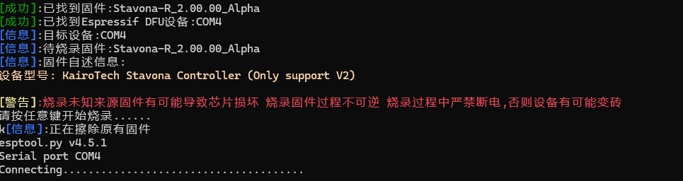

# Q&A
> Troubleshooting any problem without the error log is like driving with your eyes closed.
> 
> 在没有错误日志的情况下诊断任何问题无异于闭眼开车。

**为什么我不能到手即玩？**

由于控制器生产批次的原因，可能没有内置固件，需要手动刷入

固件升级方法：下载群内或者release内最新的安装包解压，按住设备正面的三个按键中最左侧的一个按键插入设备（按住按键插入设备后即可松开按键），然后打开Updater.exe

**在自检界面卡住/游戏卡键该怎么办？**

重新插拔控制器即可
